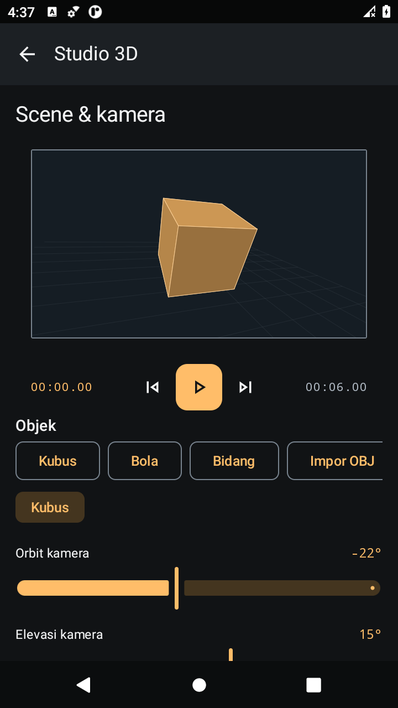
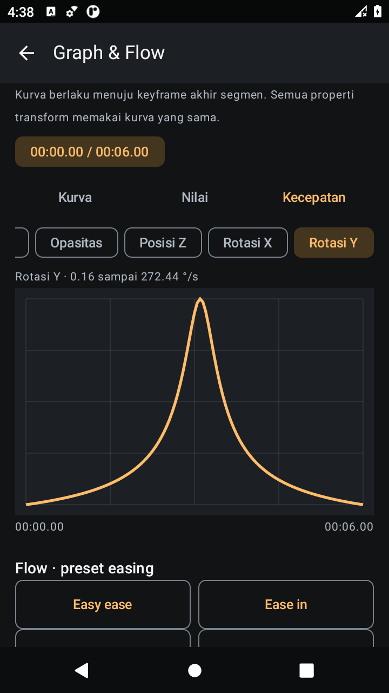

# Guswan Motion 0.2.0

[Unduh APK Guswan Motion 0.2.0](https://github.com/guswanreal/guswanapp/raw/refs/heads/apk-download/guswan-motion-v0.2.0.apk)

[Unduh proyek Android Studio (ZIP)](https://github.com/guswanreal/guswanapp/raw/refs/heads/apk-download/guswan-motion-android-studio-v0.2.0.zip)

Android 8.0+, build debug. Package dan kunci penandatanganan sama dengan versi 0.1.0; APK dapat dipasang sebagai pembaruan.

## Fitur baru

- Beranda dengan banyak proyek lokal, preview, pencarian, salin/hapus dan impor .gwm.
- Studio 3D dasar: kubus, bola, bidang, impor OBJ, kamera orbit, wireframe, transform XYZ dan animasi.
- Graph nilai/kecepatan, handle cubic Bézier dan preset Flow bawaan.
- Impor video pendek, time remap, speed ramp, freeze dan reverse. Preview dan ekspor memakai waktu hasil remap.
- Face tracking dari video: model lokal ML Kit menghasilkan posisi, skala dan estimasi sudut kepala XYZ sebagai keyframe objek wireframe, disampel 5 fps.
- Brightness, saturation dan blending Add/Multiply/Screen untuk 2D; warna/brightness untuk mesh 3D.
- UI editor, tombol tutup panel, beranda dan panduan fitur diperbarui.

Fitur sebelumnya tetap tersedia: teks/bentuk/gambar, timeline, keyframe, undo/redo, autosave, ekspor PNG, MP4 H.264 dan proyek .gwm. Proyek versi 0.1 bisa dibuka; proyek baru disimpan dalam format v2.

## Cara memakai

1. Unduh APK di HP Android dan buka file hasil unduhan. Jika diminta Android, izinkan pemasangan dari browser/pengelola file tersebut.
2. Pilih **Proyek baru** atau **Studio 3D baru** di Beranda.
3. Gunakan **Tambah** untuk layer, lalu pilih layer di timeline.
4. Buka **Alat** untuk Graph & Flow, Time remap, Studio 3D, atau Face tracking.
5. Untuk graph, buat minimal dua keyframe. Untuk tracking, impor dan pilih layer video dahulu.
6. Buka **Ekspor** untuk PNG, MP4 atau cadangan proyek .gwm.

## Batas versi ini

- Durasi komposisi 1–30 detik; maksimum 40 layer, video 12 MB dan proyek 24 MB.
- Video dan ekspor MP4 tanpa audio; pengambilan frame terdekat, belum optical flow. Tetap buka app saat ekspor/tracking.
- Studio memakai mesh polygon dan kamera perspektif sederhana; belum edit mesh/rigging/material nodes atau engine Blender.
- Face tracking merupakan estimasi pose kepala, belum face mesh/depth terkalibrasi atau camera tracking scene 3D. Kualitas tergantung video; ulangi jika transform/remap sumber berubah.
- Flow adalah preset easing bawaan. Plugin Adobe .aex/.jsx dan proyek .aep/Alight Motion tidak dijalankan.
- Masking/roto/keying, audio mixing, precomp/parenting, expressions, motion blur, stabilization/particles, dan banyak fitur AE/Blender lain belum tersedia. Daftar lengkap ada di **Fitur & panduan** dalam app.

Checksum APK ada di `SHA256SUMS`.

## Validasi

35 unit test dan tujuh uji perangkat lulus. Kedua alur UI diulang setelah perbaikan gaya; APK terakhir kembali lulus uji workspace dan rotasi portrait–landscape–portrait dengan Activity/proyek yang sama. Codec MP4 dan model face detector diuji sungguhan di emulator Android 11. HP fisik belum diuji.

[Laporan pemeriksaan dan batas pengujian](VALIDATION.md) · [Hasil terstruktur](validation/validation-results.json)

## Cuplikan pengujian emulator

Gambar ini berasal dari proyek uji, bukan proyek pengguna yang dibundel ke app.

 

[Beranda](previews/home.png) · [Graph & Flow](previews/graph-flow.png) · [Time remap](previews/time-remap.png) · [Editor landscape](previews/editor-landscape.png)
